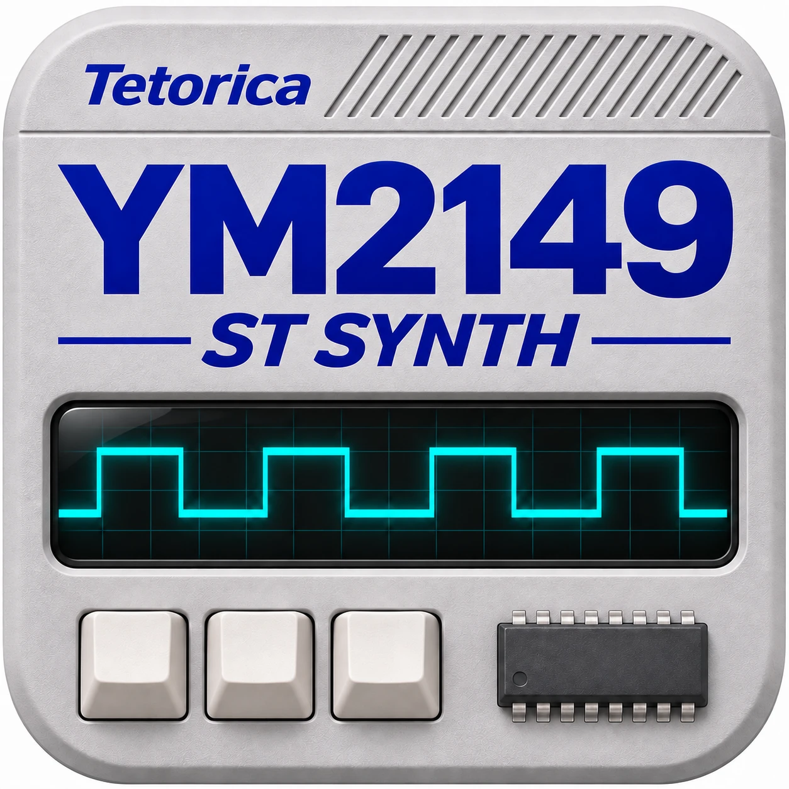

# Tetorica ST YM2149 Synth — Desktop



Explore Atari ST sound in a Tauri desktop app. This repository wraps
[Tetorica ST YM2149 Synth](https://kyorohiro.github.io/hello_ymfm_wasm/synth-ym2149-st/index.html)
with the Menu, Pin, native file saving and audio-output controls used by the
other Tetorica Synths. The initial desktop version is **0.0.1**.

The imported Web release and its file hashes are pinned in
[release.lock.json](release.lock.json). Its readable JavaScript and CSS, matching
sound-core sources, build recipes, licenses and source receipts are included so
you can inspect the implementation and modify the app.

## Sound and desktop controls

- Three YM2149 tone channels at the Atari ST's 2 MHz clock, a shared noise
  generator and a shared hardware envelope. Auto rotates keyboard notes through
  CH1–CH3; selecting a channel aligns its display, controls and keyboard target.
- Keyboard / Code, Files / Cassette, readable preset JSON and VGM / VGZ, SNDH
  and YM reference playback. Live shows a selected reference channel; Pause
  allows keyboard audition and Capture to Synth.
- JavaScript examples for Sync-buzzer envelope retriggering, fixed-volume
  modulation and generated percussion through timed volume-register writes.
  `build()`, `compile()` and `schedule()` let you record operations, inspect
  concrete register writes and reserve their execution on the AudioWorklet.
- One **Menu** for projects, imports, exports, audio output and reload. **Pin**
  keeps the window on top. Reload asks before clearing playback state.
- **Web Audio** is the default. **Native (Rust)** routes the same final stereo
  Master bus to a CPAL device. Changing output stops Code, reference playback
  and held notes and resets Pitch while retaining the current instrument.

Both output modes use the same WASM / AudioWorklet chip renderer. Native output
does not add a second chip renderer or a separate Native implementation of the
timed API. The waveform / spectrum monitor remains on the final Master bus.
The timed examples use host sample scheduling rather than original Atari ST
CPU / MFP timer timing. See the [included Synth guide](dist/README.md) for the
hardware controls, reference formats and API limits.

## Run locally

Install Node.js, Python 3, Rust and the platform's Tauri prerequisites, then run:

```sh
npm ci
python3 scripts/import_release.py --check
npm test
cargo test --manifest-path src-tauri/Cargo.toml --locked
npm run dev
```

On Windows, use `python` if Python is not available as `python3`.

Build a local unsigned macOS application:

```sh
npm run build -- --bundles app --no-sign -- --locked
```

The default output is
`src-tauri/target/release/bundle/macos/Tetorica ST YM2149 Synth.app`.
For signed Intel and Apple Silicon app / DMG builds, set `APPLE_PASSWORD` in
your shell and run `sh deploy_mac.sh`, using the certificate already installed
on your Mac. Credentials and certificates are not stored in this repository.

## Import a Web release and set the app version

```sh
npm run import:release -- --version 0.0.1 /path/to/tetorica_ym2149_st_synth_VERSION_itch.zip
python3 scripts/import_release.py --check
```

`--version` sets the desktop version independently of the ZIP filename. It
updates `package.json`, `package-lock.json`, `src-tauri/Cargo.toml`, this app's
entry in `src-tauri/Cargo.lock`, and `src-tauri/tauri.conf.json`. Omit it to keep
the current desktop version. Dependency versions remain pinned.

After import and checks, run the local release build, review the final lock
files, then commit the Web files, receipt and version metadata before tagging.
The importer does not build, commit, tag or publish anything.

Before replacing `dist/`, the importer validates the product identity, readable
browser modules, WASM and matching AY / AtariAudio / Code-effect source receipts
and licenses. Track both `dist/` and `release.lock.json` in Git. `.gitattributes`
preserves the imported bytes on Windows and other platforms.

The desktop repository uses the name `tetorica-st-ym2149-synth-tauri`. The
imported Web release keeps its existing technical paths, including
`synth-ym2149-st/` and `sources/ym2149-st-synth-browser.json`.

## Inspect and modify

The application JavaScript and CSS retain their original readable modules;
they are not bundled, minified or obfuscated. The WASM loader is the original
compiler-generated file, accompanied by the matching native sources and build
recipes.

| Location | Purpose |
| --- | --- |
| [dist/synth-ym2149-st](dist/synth-ym2149-st/) | Synth UI, instrument, Code, reference player and editable examples |
| [dist/js](dist/js/) | Reusable AY / YM2149 JavaScript API and runtime dependencies |
| [dist/generated](dist/generated/) | Compiler-generated WASM loaders and binaries |
| [dist/sources/AY8910.md](dist/sources/AY8910.md) | AY / YM2149 core sources and rebuilding |
| [dist/sources/ATARI-AUDIO.md](dist/sources/ATARI-AUDIO.md) | SNDH / YM reference-player sources and rebuilding |
| [dist/sources](dist/sources/) | Browser input archive, Code-effect sources and hash receipts |
| [desktop](desktop/) | Menu / Pin, native saving and final-bus audio adapters |
| [src-tauri/src](src-tauri/src/) | Tauri host and CPAL output |

Desktop adapters are injected by the local resource server. The importer does
not rewrite the browser files. After editing files in `dist/`, record the edits:

```sh
npm run record:edits
python3 scripts/import_release.py --check
```

`local-changes.json` records edits over the original release hashes. Importing
a new ZIP replaces `dist/`; save your work in Git and reapply your edits afterward.

## Verification and CI

```sh
npm test
npm run test:browser -- --out artifacts/desktop-browser.json --screenshots artifacts/screenshots
cargo test --manifest-path src-tauri/Cargo.toml --locked
```

Browser checks use real WASM / AudioWorklets and mocked desktop IPC with muted
speakers. They do not replace real-device listening. Rust unit tests avoid
opening an audio output device. Actual results and remaining manual checks are
recorded in the [verification notes](docs/verification_20261117.md) and
[TODO](docs/todo_20261117.md).

[Build Desktop](.github/workflows/build-desktop.yml) configures macOS Apple
Silicon / Intel, Windows x64 and Linux x64 / ARM64 builds. Main-branch builds
produce workflow artifacts. A `v*` tag attaches installers to a **draft** GitHub
release. Hosted builds are unsigned and do not require a signing certificate
or Apple password. `deploy_mac.sh` uses the local Mac's signing setup. Hosted
results require pushing the repository and completing its workflows.

## Sources and licenses

The desktop wrapper uses the [BSD 3-Clause license](LICENSE). The MAME-derived
AY / YM2149 core retains its BSD-3-Clause notices. AtariAudio keeps its MIT
license, Musashi notice, public-domain ICE attribution and LZH credits. These
notices remain under [dist/licenses](dist/licenses/) and
[dist/sources](dist/sources/). Retain the applicable notices when reusing code.
No commercial game music or samples are included.

- [Tetorica project](https://github.com/kyorohiro/hello_ymfm_wasm)
- [ST YM2149 Synth source](https://github.com/kyorohiro/hello_ymfm_wasm/tree/main/docs/synth-ym2149-st)
- [Tetorica native sound-chip library](https://github.com/kyorohiro/tetorica-soundchip-native)
- [AtariAudio](https://github.com/arnaud-carre/AtariAudio)
- [Tauri](https://tauri.app/)

## 日本語

Atari STのYM2149を試せるTetorica ST YM2149 SynthのTauri版です。Web版の
読みやすいJavaScript・CSSと、対応する音源コアのソース・ビルド手順・ライセンスを
含みます。改造するときは`dist/synth-ym2149-st/`から読み始められます。

Menu・Pin・ネイティブ保存・音声出力設定を追加します。初期状態はWeb Audioです。
Native出力も同じWASM／AudioWorkletを使い、最後のステレオMaster出力をRustから
デバイスへ送ります。Codeやタイミング予約を別の音源実装へ切り替えるものではありません。

`npm run import:release -- --version 版番号 ZIPのパス`でWeb版を取り込み、アプリの
版番号も更新できます。`dist/`を直接編集した後は`npm run record:edits`で記録します。
実デバイスでの実聴・長時間動作・署名済み配布物の確認はTODOを参照してください。
